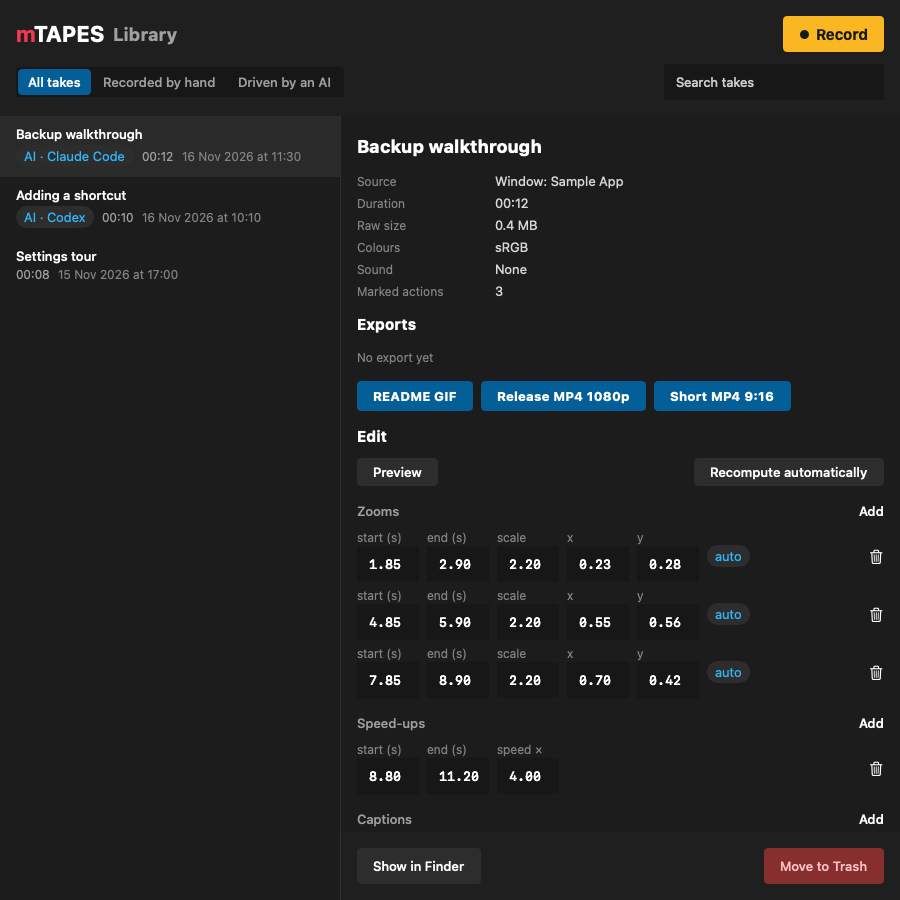

# mTAPES

A native macOS screen recorder that edits your demos for you, and that any AI can drive through MCP.

🇬🇧 English · 🇫🇷 [Français](#français)

## About

mTAPES is made by Starbudweiser & Claude Code (Anthropic). Part of the **DESKTOP MAC TOOLKIT**. MIT License, © 2026 Starbudweiser. Provided as is, without warranty. "About mTAPES" is in the app menu.



## Status

**Version 1.0.1.** A menu-bar app for macOS 15+ on Apple Silicon (Screen Recording permission), signed and notarized, with automatic updates (a daily check of the GitHub releases, signature and bundle-id verification, never while recording or exporting; switch off or check by hand in the menu-bar item *Check for Updates…*). Install: download `mTAPES-<version>-macOS-arm64.zip` from the [Releases page](https://github.com/starbudweiser/mTAPES/releases/latest), unzip, and move mTAPES.app to Applications.

- **Record**: a screen, a window (even covered, even moved while recording), an application or a zone (shortcut ⌥⌘R); saves a `.tape` take in `~/Movies/mTAPES`. A take stops cleanly when the Mac sleeps, the screen locks or the screen resolution changes.
- **Sound**: the Mac's sound and/or the microphone, recorded as separate tracks; kept at normal speed in the film (sped-up parts are muted, so a voice is never distorted), with a gain per track.
- **Colour**: sRGB (default, right for the web and GIFs) or Display P3 end to end (capture, take, render, MP4 tags). HDR screens are filmed in SDR on purpose.
- **Finish**: automatic zooms, sped-up dead time, captions, smoothed cursor, frame and background; exports GIF (README), MP4 1080p (release) and vertical MP4 (short).
- **Edit**: take library, hand-editing of zooms, speeds and captions with a live preview; the raw video is never modified.
- **AI**: MCP server (10 tools) so any AI can record, announce its actions and edit the take itself.
- **Two modes** (Simple / Advanced) and a setup assistant; French, English, Spanish, Italian.
- **Not yet**: HDR video (screens are filmed in SDR), an on-device editing engine when no AI is connected. A window that grows beyond its starting size is cropped (its moves are followed).

Design mockups: [`maquettes/index.html`](maquettes/index.html); plan: [`ARCHITECTURE.md`](ARCHITECTURE.md) (French). Click/video sync measured under one frame (6 to 18 ms); sound/video sync within 2 ms.

## AI auto-edit

The connected AI edits the take itself (`tapes_summary` → `tapes_apply_plan` → `tapes_export`), validated and bounded by mTAPES, at no extra cost. See [PROMPTING.md](PROMPTING.md).

## MCP: let an AI record and finish the demo

The app embeds an MCP server so Claude Code, Codex, Cursor or any MCP client can start a take, **announce each action it performs**, stop, then get a finished demo.
It is **off by default**: tick **AI control** in the mTAPES menu-bar menu (the icon then shows "IA"). A client must also be **allowed once** ("Allow <client>" in the same menu, or in the **AI control…** window); nothing is recorded before that.

- **One-click connection**: *AI control…* detects Claude Code, Claude Desktop, Cursor, Codex and Gemini CLI and connects them (your existing configuration is backed up and kept). Or by hand: `claude mcp add mtapes -- "/Applications/mTAPES.app/Contents/MacOS/mtapes-cli" mcp`.
- **Clients without a command line** can use the optional local HTTP server (`http://127.0.0.1:47321/mcp`, bearer token, this computer only).
- **Tools**: `tapes_list_targets`, `tapes_start` (screen, one window even if covered, one app, or a zone; optional `audio` = system / mic / both and `color` = srgb / p3), `tapes_mark` (click, type, scroll, key, chapter, with position and a human label; `space=window` for window-relative positions), `tapes_status`, `tapes_stop`, `tapes_list`,
  `tapes_finish` (plan zooms on the marked actions, speed up dead time, caption from your labels) and `tapes_export` (`readme` = light GIF, `release` = 1080p MP4, `short` = vertical 9:16 MP4).
- Screen commands go to the app (which holds the Screen Recording permission) over a private Unix socket (mode 600, same user only); finishing and export run in the MCP process, one render at a time. A take also stops by itself after `max_seconds` (default 600).
- Tests: `tests/mcp_e2e.py` (a real take driven over MCP, finished and exported).

## Automatic finishing

A take is raw and untouched; the finishing layer (`finition.json`) is recomputed at will: zooms (eased) on the actions, dead time sped up, smoothed cursor redrawn with click ripples, captions from the labels the AI announced (never invented), rounded window on a gradient background with shadow, 16:9 or 9:16.
`mtapes finish TAPE --preset release` then `mtapes export TAPE --dest release`. On a synthetic 8.8 s source the render takes about 1.4 s (1080p60) to 2 s (GIF); real demos have not been measured yet.

## What works today: the engine

`mtapes` records into a `.tape` package (raw HEVC video, `events.jsonl`, `pointer.bin`, `meta.json`):

- ScreenCaptureKit capture of a display, a window, an application or a zone; the cursor is not baked into the video.
- Adaptive frame rate (only changed frames are written), hardware HEVC with constant quality, a key frame every second, fragmented file (a crash leaves a playable file).
- Click, double-click and drag detection from the button state (no extra permission; a press shorter than ~8 ms can be missed).
- Crash-tolerant takes: the video is fragmented and events are saved every 5 s (verified with a forced kill).

```sh
swift build -c release
.build/release/mtapes doctor                       # permissions, hardware encoder
.build/release/mtapes targets                      # displays, windows, applications
.build/release/mtapes record --seconds 10 --out ~/Movies/mTAPES --profile balanced
.build/release/mtapes bench --seconds 20           # CPU, dropped frames, size, latency
```

First measurements are in [`bench/RESULTS.md`](bench/RESULTS.md) (Apple M5 Max, 3440 × 1440: no frame refused by the encoder over a 30-minute take, about 10 MB per minute at the Balanced profile, about 0.2 CPU core attributable to recording). They are early and incomplete (visual quality, long recordings and comparisons are not measured yet); only measured numbers will be published. Requires macOS 15 or later on Apple Silicon and the Screen Recording permission.

---

## Français

Un enregistreur d'écran macOS natif qui monte vos démos tout seul, et que n'importe quelle IA peut piloter par MCP.

**À propos** : mTAPES est réalisé par Starbudweiser & Claude Code (Anthropic). Fait partie du **DESKTOP MAC TOOLKIT**. Licence MIT, © 2026 Starbudweiser. Fourni en l'état, sans garantie.

**État** : version 1.0.1, appli de barre de menus (macOS 15+, Apple Silicon), signée, notarisée, avec mise à jour automatique (recherche quotidienne, jamais pendant une prise ou un export, réglable depuis « Rechercher les mises à jour… ») ; installation : télécharger le zip depuis la [page Releases](https://github.com/starbudweiser/mTAPES/releases/latest), le décompresser et glisser mTAPES.app dans Applications. Enregistrement d'un écran, d'une fenêtre, d'une appli ou d'une zone ; finition automatique (zooms, temps morts accélérés, légendes, curseur, cadre) ; exports GIF, MP4 1080p et vertical ; bibliothèque et retouche à la main avec aperçu ; serveur MCP (10 outils) pour qu'une IA enregistre et monte ; modes Simple et Avancé ; 4 langues. Son (son du Mac, micro) en pistes à part, couleurs sRGB ou Display P3. **Pas encore** : vidéo HDR (les écrans sont filmés en SDR), moteur de montage local sans IA. Maquettes : [`maquettes/index.html`](maquettes/index.html) ; plan : [`ARCHITECTURE.md`](ARCHITECTURE.md). Chiffres mesurés : [`bench/RESULTS.md`](bench/RESULTS.md).

## Support / Soutenir

This app is free. If it is useful to you, you can support the project (optional, no reward expected): [GitHub Sponsors](https://github.com/sponsors/starbudweiser).

Cette appli est gratuite. Si elle vous est utile, vous pouvez soutenir le projet (facultatif, sans contrepartie) : [GitHub Sponsors](https://github.com/sponsors/starbudweiser).
